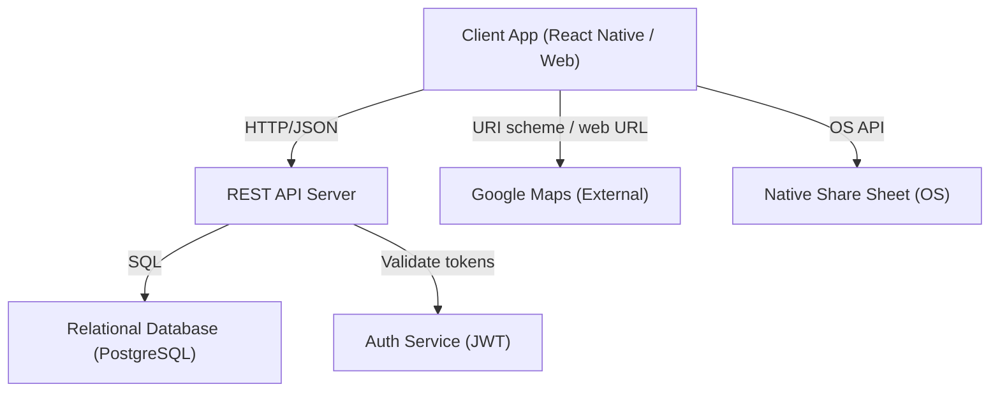

# Design Document: Campus Event Finder

## Overview

The Campus Event Finder is a mobile/web application with two primary tabs: an Events tab for browsing and searching campus events, and a Sports tab for discovering and posting one-time play sessions. The app integrates with Google Maps for navigation and uses the device's native share sheet for event sharing. Authentication is required for session management actions.

The architecture follows a client-server model with a React Native (or React web) frontend, a REST API backend, and a relational database. Google Maps integration is handled client-side via URI schemes and the Maps web URL fallback.

---

## Architecture



Key design decisions:
- Location detection (on/off campus) is done client-side using the device's Geolocation API compared against a stored campus boundary polygon.
- Google Maps is launched via deep link (URI scheme on iOS/Android) with a web URL fallback — no server involvement needed.
- The native share sheet is invoked entirely client-side.
- Search filtering is performed server-side to keep the client lightweight and support future pagination.

---

## Components and Interfaces

### Client Components

| Component | Responsibility |
|---|---|
| `EventsTab` | Renders the event list, search input, and navigates to event detail |
| `EventDetailView` | Displays full event info, share button, and conditional "Get Directions" button |
| `SportsTab` | Renders session post list, search input, and create post button |
| `SessionPostForm` | Form for creating/editing a Session_Post with validation |
| `SessionPostDetail` | Displays a session post; shows edit/delete if owned by current user |
| `LocationService` | Determines on/off campus status using device geolocation |
| `MapsService` | Constructs and launches Google Maps URI or web URL |
| `ShareService` | Invokes the native share sheet with composed share content |
| `AuthService` | Manages login, token storage, and session expiry |

### API Endpoints

```
GET    /events                  # List upcoming events (ordered by date asc)
GET    /events?q={query}        # Search events by keyword
GET    /events/:id              # Get event detail

GET    /sessions                # List active session posts
GET    /sessions?q={query}      # Search session posts by sport/keyword
POST   /sessions                # Create a session post (auth required)
PUT    /sessions/:id            # Edit a session post (auth required, owner only)
DELETE /sessions/:id            # Delete a session post (auth required, owner only)

POST   /auth/login              # Authenticate and receive JWT
POST   /auth/refresh            # Refresh an expiring session token
```

### LocationService Interface

```typescript
interface LocationService {
  getCurrentLocation(): Promise<Coordinates>;
  isOnCampus(coords: Coordinates): boolean; // compares against campus boundary polygon
}
```

### MapsService Interface

```typescript
interface MapsService {
  openDirections(address: string): Promise<void>;
  // Tries native URI scheme first, falls back to web URL
}
```

### ShareService Interface

```typescript
interface ShareService {
  shareEvent(event: Event): Promise<void>;
  // Composes title, date, time, location, summary, and optional URL
}
```

---

## Data Models

### Event

```typescript
interface Event {
  id: string;
  title: string;
  description: string;
  category: string;
  date: string;           // ISO 8601 date
  time: string;           // HH:MM local time
  locationName: string;
  campusAddress: string;
  price?: number;         // null/undefined = free
  entryRequirements?: string;
  deepLinkUrl?: string;
}
```

### SessionPost

```typescript
interface SessionPost {
  id: string;
  creatorId: string;      // references Student.id
  sport: string;
  participantsNeeded: number;  // >= 1
  skillLevel: string;
  scheduledAt: string;    // ISO 8601 datetime
  description: string;
  isActive: boolean;      // false when deleted or session is full
}
```

### Student (User)

```typescript
interface Student {
  id: string;
  email: string;          // campus credentials
  displayName: string;
  passwordHash: string;
}
```

### AuthSession

```typescript
interface AuthSession {
  studentId: string;
  token: string;          // JWT
  expiresAt: string;      // ISO 8601 datetime
}
```

### Campus Boundary

Stored as a GeoJSON polygon in configuration (not in the database), representing the campus geographic boundary used by `LocationService.isOnCampus()`.

---

## Correctness Properties

*A property is a characteristic or behavior that should hold true across all valid executions of a system — essentially, a formal statement about what the system should do. Properties serve as the bridge between human-readable specifications and machine-verifiable correctness guarantees.*

### Property 1: Event list ordering and filtering

*For any* collection of events with varying dates (past and future), the events returned by the list endpoint should contain only events with a date on or after the current date, and should be ordered by date ascending.

**Validates: Requirements 1.1, 1.2**

---

### Property 2: Event list item rendering completeness

*For any* Event object, the rendered list item should always include the title, date, time, and location name; should include the price if and only if a price is set; and should include a summary of entry requirements if and only if entryRequirements is defined.

**Validates: Requirements 1.4, 1.5**

---

### Property 3: Event search correctness

*For any* collection of events and any keyword query string, every event returned by the search should contain the query string in its title, description, or category — and no event that matches the query should be excluded from the results.

**Validates: Requirements 2.2**

---

### Property 4: Search clear restores full list

*For any* initial list of upcoming events and any search query applied to it, clearing the search input should restore the result to the same set of events as the unfiltered list.

**Validates: Requirements 2.4**

---

### Property 5: Event detail view rendering completeness

*For any* Event object, the rendered detail view should always include the title, full description, date, time, location name, and campus address; should include the price if and only if a price is set; and should include the full entry requirements text if and only if entryRequirements is defined.

**Validates: Requirements 3.1, 3.2, 3.3**

---

### Property 6: Directions button visibility based on location context

*For any* event and any determined location context, the "Get Directions" button should appear in the event detail view if and only if the student's location context is off campus (or location is undetermined as a fallback).

**Validates: Requirements 3.4, 4.3, 4.7**

---

### Property 7: Maps navigation uses correct address

*For any* event with a campus address, when the student taps "Get Directions", the MapsService should be invoked with exactly that event's campusAddress as the destination parameter.

**Validates: Requirements 3.5, 4.4**

---

### Property 8: Campus boundary detection

*For any* geographic coordinates, the LocationService should return `true` (on campus) if and only if those coordinates fall within the campus boundary polygon, and `false` otherwise.

**Validates: Requirements 4.1**

---

### Property 9: Session post list shows only active posts with open slots

*For any* collection of session posts with varying `isActive` states and `participantsNeeded` values, the Sports_Tab list should display only posts where `isActive` is true and `participantsNeeded` is greater than or equal to 1.

**Validates: Requirements 5.1, 5.2**

---

### Property 10: Session post rendering completeness

*For any* SessionPost object, the rendered list item should always include the sport name, number of participants needed, skill level, scheduled date and time, and description.

**Validates: Requirements 5.3**

---

### Property 11: Session post search correctness

*For any* collection of session posts and any keyword query string, every post returned by the search should contain the query string in its sport name or description — and no matching post should be excluded.

**Validates: Requirements 6.2**

---

### Property 12: Session post search clear restores full list

*For any* initial list of active session posts and any search query applied to it, clearing the search input should restore the result to the same set of active posts as the unfiltered list.

**Validates: Requirements 6.4**

---

### Property 13: Session post validation rejects incomplete submissions

*For any* session post submission where one or more required fields (sport name, participantsNeeded, scheduledAt, description) are missing or where participantsNeeded is less than 1, the submission should be rejected with a validation error and the post should not be published.

**Validates: Requirements 7.2, 7.4**

---

### Property 14: Session post creation round-trip

*For any* valid session post submitted by an authenticated student, the post should appear in the Sports_Tab list and its `creatorId` should equal the submitting student's id.

**Validates: Requirements 7.3, 7.5**

---

### Property 15: Edit/delete options visible only to post owner

*For any* session post and any authenticated student, the edit and delete options should appear if and only if the student's id matches the post's `creatorId`.

**Validates: Requirements 8.1**

---

### Property 16: Session post edit round-trip

*For any* session post and any valid set of edits applied to it, the updated values should be reflected in the Sports_Tab list after the edit is saved.

**Validates: Requirements 8.2**

---

### Property 17: Session post deletion removes from list

*For any* session post that exists in the Sports_Tab list, after the owning student deletes it, the post should no longer appear in the list.

**Validates: Requirements 8.3**

---

### Property 18: Edit form pre-population

*For any* session post with existing field values, opening the edit form should pre-populate every field with the post's current data.

**Validates: Requirements 8.4**

---

### Property 19: Share content composition completeness

*For any* Event object, the composed share content should always include the event's title, date, time, location name, and a plain-text summary; and should include the deepLinkUrl if and only if one is set on the event.

**Validates: Requirements 9.3, 9.4**

---

### Property 20: Unauthenticated requests to session management are rejected

*For any* request to create, edit, or delete a session post that does not include a valid authentication token, the system should reject the request and not perform the operation.

**Validates: Requirements 10.1**

---

## Error Handling

| Scenario | Behavior |
|---|---|
| No upcoming events | Display "no events currently scheduled" message |
| Event search returns no results | Display "no matching events found" message |
| No active session posts | Display "no play sessions looking for participants" message |
| Session post search returns no results | Display "no play sessions found for that sport" message |
| MapsService unavailable (Google Maps not installed) | Open Google Maps web URL in default browser |
| MapsService completely unavailable | Display error message and show campus address as plain text |
| Location detection fails | Default to showing "Get Directions" button as fallback |
| Native share sheet unavailable | Display error message: "Sharing is not supported on this device" |
| Invalid login credentials | Display authentication error; do not grant access |
| Session token expired | Prompt re-authentication before account-specific actions |
| Session post submission with missing fields | Display validation error identifying each missing field; do not publish |
| Unauthenticated session management request | Return 401; prompt login |

---

## Testing Strategy

### Unit Tests

Focus on specific examples, edge cases, and error conditions:

- Empty event list renders the correct empty-state message
- Empty session post list renders the correct empty-state message
- Event detail view with no price does not show a price field
- Event detail view with no entry requirements does not show requirements text
- MapsService falls back to web URL when native URI scheme fails
- LocationService returns correct result for coordinates exactly on the campus boundary
- Session post form shows validation errors for each individual missing field
- Auth error message is shown for invalid credentials
- Re-auth prompt is shown when session token is expired
- Share sheet error message is shown when share sheet is unavailable

### Property-Based Tests

Use a property-based testing library (e.g., `fast-check` for TypeScript/JavaScript) with a minimum of 100 iterations per property. Each test should be tagged with a comment referencing the design property it validates.

Tag format: `// Feature: campus-event-finder, Property {N}: {property_text}`

Properties to implement as property-based tests:

| Property | Test Focus |
|---|---|
| Property 1 | Generate random event sets with mixed past/future dates; verify ordering and filtering |
| Property 2 | Generate random Event objects with optional price/requirements; verify list item rendering |
| Property 3 | Generate random event collections and query strings; verify search correctness |
| Property 4 | Generate event lists and queries; verify clear restores original list |
| Property 5 | Generate random Event objects; verify detail view rendering completeness |
| Property 6 | Generate random events + mock location context; verify button visibility |
| Property 7 | Generate random events; verify MapsService receives correct address |
| Property 8 | Generate random coordinates inside/outside campus polygon; verify isOnCampus |
| Property 9 | Generate session posts with varying isActive/participantsNeeded; verify list filtering |
| Property 10 | Generate random SessionPost objects; verify rendering completeness |
| Property 11 | Generate session post collections and queries; verify search correctness |
| Property 12 | Generate session post lists and queries; verify clear restores original list |
| Property 13 | Generate submissions with random missing/invalid fields; verify rejection |
| Property 14 | Generate valid posts with random student accounts; verify creation round-trip |
| Property 15 | Generate posts and students with varying ownership; verify edit/delete visibility |
| Property 16 | Generate posts and random valid edits; verify edit round-trip |
| Property 17 | Generate posts; delete them; verify absence from list |
| Property 18 | Generate posts with random field values; verify edit form pre-population |
| Property 19 | Generate random Event objects with optional deepLinkUrl; verify share content |
| Property 20 | Generate session management requests without valid tokens; verify rejection |

### Integration Tests

- End-to-end: create a session post, verify it appears in the list, edit it, verify changes, delete it, verify removal
- Authentication flow: login with valid credentials, perform an auth-required action, verify success
- Google Maps integration: verify correct URI scheme is constructed for a known address
- Search integration: verify search endpoint returns correct results against a seeded database
